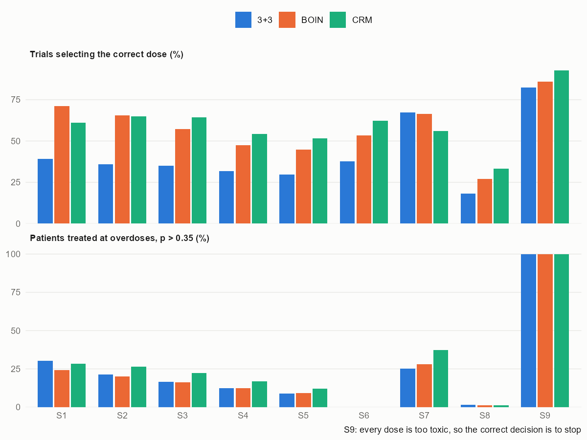

# Dose finding in first-in-human oncology trials: 3+3, BOIN and CRM

Most first-in-human oncology trials still pick the maximum tolerated dose with the 3+3 rule, although model-assisted and model-based designs such as BOIN and the continual reassessment method (CRM) are known to find it more often. Newer guidance on dose optimization also asks sponsors to compare more than one dose before a registration trial. This project simulates all three escalation designs on the same patients and then works out, exactly, how many patients per arm a randomized two-dose comparison needs.

The 3+3, BOIN and CRM rules are written out in `R/designs.R` so that every design sees the same simulated patients in the same order and their results can be compared trial by trial. The code is checked against the reference packages before any result is read: the 3+3 simulation against an exact enumeration of every path of the design, BOIN against `BOIN::get.oc`, and the CRM against `dfcrm::crm`, both data set by data set and whole trial by whole trial.

The plan, with predictions and the rules for reading the results, is in [docs/design.md](docs/design.md). It was written before any simulation was run.

Status: done; the readout is [docs/readout.md](docs/readout.md). Across eight fixed scenarios BOIN and the CRM selected the correct dose in 54% and 56% of trials against 37% for 3+3, and over 1,000 random dose-toxicity curves in 71%, 69% and 43%. 3+3 used half the patients but stopped below the right dose in more than half of the trials, and per patient it was not safer than BOIN. The CRM did best when the right dose was the highest and worst when toxicity jumped steeply between doses. For a two-dose comparison with a 40% response rate and a margin of 0.10, 33 patients per arm give about 80% for both correct decisions, and every n from 40 does.

```
$ Rscript scripts/verdicts.R
       id                                                check value    met
1:     P1          BOIN - 3+3, S1-S8 correct selection (>= 10)  17.3   TRUE
2:     P1           CRM - 3+3, S1-S8 correct selection (>= 10)  19.2   TRUE
3:     P2                            |BOIN - CRM|, S1-S8 (< 5)   1.9   TRUE
4:     P2                           |BOIN - CRM|, random (< 5)   1.5   TRUE
5:     P3      3+3 - BOIN, % patients at overdoses S1-S8 (< 0)   0.6  FALSE
6:     P3       3+3 - CRM, % patients at overdoses S1-S8 (< 0)  -3.5   TRUE
7:     P3                      3+3 under-dosing, S2-S6 (>= 30)  54.0   TRUE
8:     P4 3+3 minus best other, random correct selection (< 0) -28.3   TRUE
9:     P5      smallest n per arm, pH 0.40, delta 0.10 (30-50)  33.0   TRUE
```



## Run

From the project folder, with R 4.4 and the packages BOIN, dfcrm, data.table, ggplot2 and testthat:

```
Rscript -e "testthat::test_dir('tests')"
Rscript scripts/run_fixed.R
Rscript scripts/check_designs.R
Rscript scripts/run_random.R
Rscript scripts/run_partb.R
Rscript scripts/verdicts.R
Rscript scripts/figures.R
```

The fixed scenarios take about 12 seconds on 9 cores and the random scenarios about a minute on 16; the simulations run in parallel with the base `parallel` package. Part B needs no simulation, since the selection probabilities are sums over two binomial distributions; `run_partb.R` still checks them against 100,000 simulated comparisons. Results were produced with BOIN 2.7.2 and dfcrm 0.2.2.1.

## License

The code is under the MIT license.

Can Zhang, zhan8639@umn.edu
