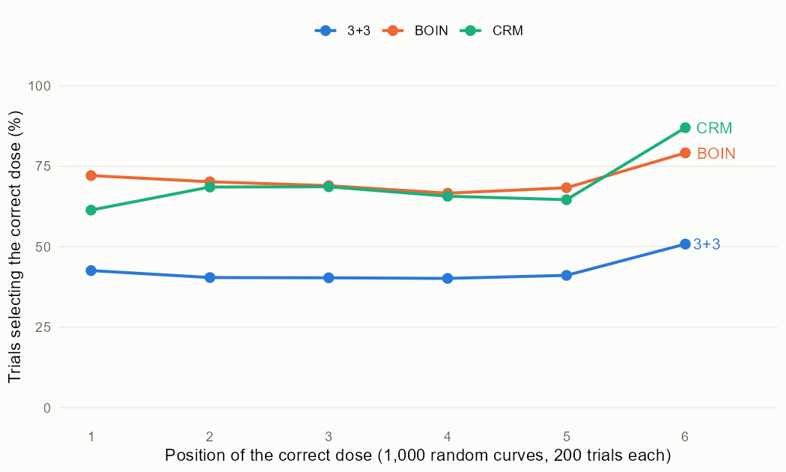
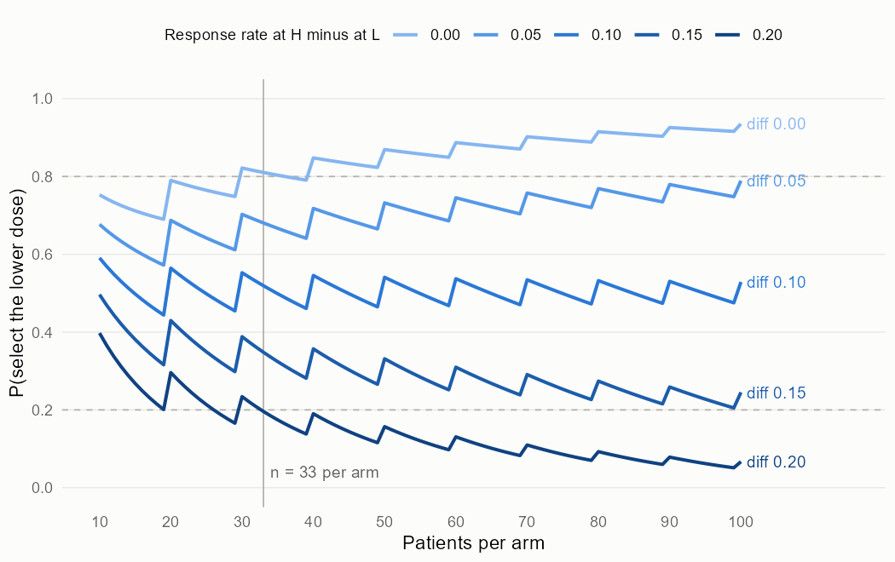

# Readout: 3+3, BOIN and CRM, and the size of a two-dose comparison

The plan, with the predictions and the rules for reading them, is in [design.md](design.md). Every number below is in `results/`.

## Summary

BOIN and the CRM found the right dose far more often than 3+3. In the eight fixed scenarios that have a correct dose, they selected it in 54% and 56% of trials against 37% for 3+3, and over 1,000 random dose-toxicity curves in 71%, 69% and 43%. The price of 3+3's small size (17 patients on average against about 35) is under-dosing: when the correct dose was the second to the sixth, it stopped below it in 54% of trials.

3+3 was not safer per patient than BOIN. On average over S1 to S8, 14.5% of its patients were treated at doses with a DLT rate above 0.35, against 13.9% for BOIN and 18.1% for the CRM. This was the one prediction that was not met. Counted as patients rather than as a share (post hoc), 3+3 exposed fewer people, 2.6 per trial against 5.0 and 6.5, only because it enrolls fewer.

BOIN and the CRM were close overall but failed in different places. The CRM was best when the correct dose was the highest (S6: 62% against 53% for BOIN; random curves with the correct dose at the top: 87% against 79%) and stopped most reliably when every dose was too toxic (S9: 93%, against 86% and 82%). It overshot when toxicity jumped between two doses (S7: an overdose was selected in 43% of trials, against 31% for BOIN and 14% for 3+3) and was weaker when the lowest dose was the right one (S1: 61% against 71%). Over the random curves the CRM selected an overdose in 15.2% of trials and BOIN in 10.5%.

For dose optimization, with a 40% response rate at the higher dose and a margin of 0.10, 33 patients per arm give an 81% chance of choosing the lower dose when response has plateaued and an 80% chance of keeping the higher dose when it is 20 points better. Because responses are counts, the probabilities move in a sawtooth with n, and both targets hold for every n from 40 on (reported post hoc, Amendment 1).

## Checks of the code

All four pre-registered checks were met (`results/check_*.csv`).

| Check | Result |
|---|---|
| 3+3 simulation vs exact enumeration, 9 scenarios x 7 outcomes | largest gap 2.92 standard errors; expected patients within 1.6 |
| BOIN vs `BOIN::get.oc` | largest gap 2.18 combined standard errors |
| CRM posterior mean of beta vs `dfcrm::crm`, 200 data sets | largest difference 7.3e-6; same recommended dose in 200 of 200 |
| Whole CRM trials, fast version vs `dfcrm::crm` after every cohort | same selection in 500 of 500 |

## Part A: fixed scenarios

4,000 paired trials per scenario. Percentages of trials, except the middle columns, which are percentages of patients.

| Scenario (correct dose) | Correct selection: 3+3 / BOIN / CRM | Patients at overdoses: 3+3 / BOIN / CRM | Average patients: 3+3 / BOIN / CRM |
|---|---|---|---|
| S1 (1) | 39.1 / 71.1 / 61.0 | 30.3 / 24.2 / 28.4 | 9.1 / 32.7 / 31.8 |
| S2 (2) | 36.0 / 65.6 / 65.0 | 21.5 / 19.9 / 26.4 | 13.1 / 35.9 / 35.9 |
| S3 (3) | 35.0 / 57.3 / 64.5 | 16.6 / 16.4 / 22.4 | 16.2 / 36.0 / 36.0 |
| S4 (4) | 31.7 / 47.5 / 54.4 | 12.4 / 12.4 / 16.9 | 18.7 / 36.0 / 36.0 |
| S5 (5) | 29.7 / 44.7 / 51.6 | 8.7 / 9.3 / 12.0 | 21.0 / 36.0 / 36.0 |
| S6 (6) | 37.5 / 53.4 / 62.2 | 0 / 0 / 0 | 22.2 / 36.0 / 36.0 |
| S7 (3, steep jump) | 67.2 / 66.5 / 56.0 | 25.3 / 27.9 / 37.4 | 17.3 / 36.0 / 36.0 |
| S8 (3, flat) | 18.0 / 27.0 / 33.2 | 1.4 / 1.2 / 1.1 | 14.3 / 35.5 / 35.5 |
| S9 (stop) | 82.3 / 86.0 / 92.8 | 100 / 100 / 100 | 5.8 / 17.0 / 15.5 |

In S1 the correct dose is the lowest and sits exactly at the target, so 3+3 often sees two DLTs in six patients there and stops without a selection (46% of trials). In the flat scenario S8 the doses next to the correct one (0.20 and 0.30) are nearly as good, so low correct-selection rates for all three designs say little.

## Part A: random scenarios

1,000 curves, 200 paired trials each. Average correct selection: 3+3 42.6%, BOIN 70.9%, CRM 69.4%. Per curve, BOIN beat 3+3 on all 1,000 and the CRM beat 3+3 on 996; the CRM minus BOIN difference averaged -1.5 points (standard error 0.26) and was positive in 42% of curves.

## Predictions

| | Prediction | Result | Verdict |
|---|---|---|---|
| P1 | BOIN and CRM each at least 10 points above 3+3 in correct selection, S1 to S8 | +17.3 and +19.2 | met |
| P2 | BOIN and CRM within 5 points, fixed and random | 1.9 and 1.5 | met |
| P3 | 3+3 treats a smaller share of patients at overdoses than both, and under-doses in at least 30% of trials (S2 to S6) | 0.6 points more than BOIN, 3.5 fewer than CRM; under-dosing 54% | not met |
| P4 | 3+3 lowest in correct selection over the random curves | 42.6 against 69.4 and 70.9 | met |
| P5 | smallest n per arm for both Part B targets between 30 and 50 | 33 | met |

## Part B: randomized two-dose comparison

Exact probabilities (`results/partb_oc.csv`), response rate 0.40 at the higher dose H, margin 0.10. A 100,000-run simulation at n = 20, 40 and 60 matched them (largest gap 1.3 standard errors).

| Patients per arm | P(choose L), no difference | P(choose H), H 20 points better | P(choose L), H 10 points better |
|---|---|---|---|
| 20 | 0.79 | 0.70 | 0.56 |
| 30 | 0.82 | 0.77 | 0.55 |
| 33 | 0.81 | 0.80 | 0.52 |
| 40 | 0.85 | 0.81 | 0.55 |
| 50 | 0.87 | 0.84 | 0.54 |

Sensitivity (smallest n meeting both targets, and the n from which they always hold): response rate 0.25 at H, 23 and 30; 0.60 at H, 35 and 42. At a response rate of 0.40, a margin of 0.05 favors H too much and never met both targets within 100 per arm, and a margin of 0.15 favors L too much and met them only at n = 99. The margin has to sit near half the difference that matters.

The sawtooth comes from ties. When 0.10 x n is a whole number, an observed difference of exactly the margin counts for the lower dose, so P(choose L) jumps up at those n and decays between them. A protocol should report the exact operating characteristics at the n it uses rather than read them off a smooth approximation.

## Limits

The scenarios are stylized, DLTs are immediate and binary, and patients within a cohort are exchangeable. Real escalation also weighs pharmacokinetics, lower-grade and late toxicities, and clinical judgment; real dose optimization also weighs safety, tolerability and patient-reported outcomes. BOIN and the CRM were run with common default settings, and other skeletons, priors or stopping rules would shift the numbers, mostly in the CRM's weak spots.
